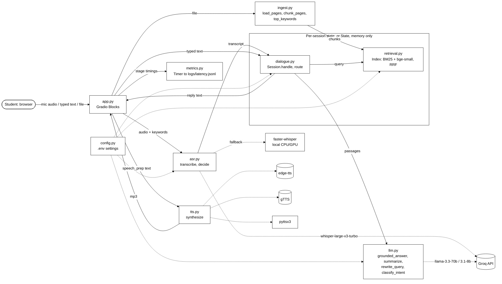
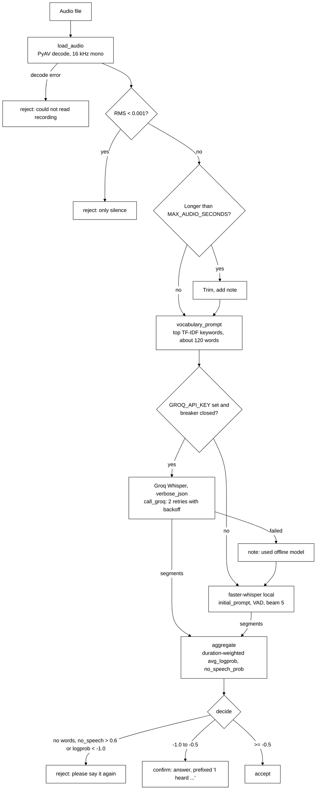
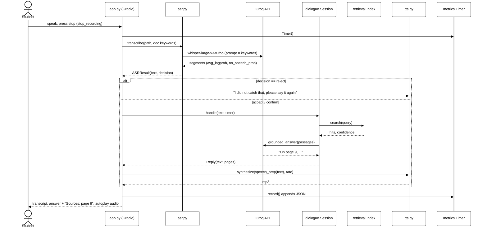

# VoiceTutor architecture

All diagrams use a black-and-white theme so they print cleanly in the report. Every module and function name below matches the code.

## 1. System architecture



## 2. ASR pipeline (`asr.transcribe`)



## 3. Dialogue and fallback flow (`Session.handle`)

```mermaid
%%{init: {'theme':'base','themeVariables':{'primaryColor':'#ffffff','primaryTextColor':'#000000','primaryBorderColor':'#000000','lineColor':'#000000'}}}%%
flowchart TD
    T[Utterance] --> RT{route: rules first<br/>commands only if 6 words or fewer}
    RT -->|no rule, not question-like,<br/>Groq available| CL[classify_intent LLM]
    CL --> RT2[intent]
    RT -->|help| HP[Help text]
    RT -->|repeat| RP[Replay cached audio<br/>no LLM, no TTS]
    RT -->|slower / faster| SP[Change rate, re-speak last reply]
    RT -->|shorter / longer| LN[Change length, re-run last request]
    RT -->|read| RD{page number?}
    RD -->|yes| RDP[Read page text<br/>warn if unreadable]
    RD -->|no| SEC[Section: search name,<br/>widen to neighbouring chunks]
    RT -->|summarize| SM[Pages / section / whole doc]
    SM --> SMG{Groq OK?}
    SMG -->|yes| SML[llm.summarize]
    SMG -->|no| EX1[Extractive: first sentences per page]
    RT -->|question| FU{Follow-up and Groq OK?}
    FU -->|yes| RW[rewrite_query, last 3 turns]
    FU -->|no| RET
    RW --> RET[Index.search, confidence = max cosine]
    RET --> TH{confidence >= 0.55?}
    TH -->|no| GK{General knowledge allowed<br/>and Groq OK?}
    GK -->|yes| GA["general_answer<br/>prefixed 'This is not from your notes.'"]
    GK -->|no| NF[I could not find that in your notes.]
    TH -->|yes| GQ{Groq OK?}
    GQ -->|yes| GR[grounded_answer]
    GR -->|NOT_FOUND| GK
    GR --> ANS[Answer + cited pages]
    GQ -->|no key / failed / breaker open| EX2[Extractive: confident passages,<br/>'From page N: ...']
```

## 4. Sequence of one voice turn


